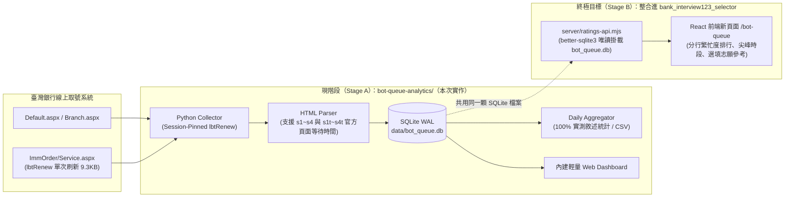

# 臺灣銀行分行叫號與排隊分析系統 — 實作與整合計畫（先 A 後 B）

> **策略定位**：現階段先以 **做法 A（獨立子目錄 `bot-queue-analytics/`，Python + SQLite 零外部強依賴架構）** 完成網站調查、資料採集、純實測統計與測試；同時在 SQLite Schema、分行代碼與 API 資料結構上**預留做法 B（無縫掛載至現有 `bank_interview123_selector` 的 Node `better-sqlite3` + React 前端）** 的橋接介面。
> **核心雙原則**：
> 1. **絕不影響臺灣銀行系統正常運作**（嚴格唯讀、單執行緒順序執行、Session-Pinned `lbtRenew` 快取、慢回應斷路器、營業時段守門員）。
> 2. **100% 真實觀測統計、零推估模型**（不跑 Little's Law 或人工外推公式；只記錄與統計頁面上真真切切的叫號號碼、現場等待人數、發生時間與臺銀官方頁面顯示的等待分鐘數）。

---

## 1. 階段演進架構圖（Stage A → Stage B）

---

## 2. Phase 0 實測結論摘要（已驗證）

1. **分行清單（164 間唯一據點）**：
   - **啟用（151 間）**：含 `003 營業部`、149 間一般分行、`205 北府簡易型分行`。
   - **停用（13 間，`disabled`）**：4 間國際機場分行（`279`、`115`、`289`、`191`）、4 間簡易型分行（`193`、`194`、`195`、`198`）、5 間一般／園區分行（`033 南門`、`034 公館`、`110 中崙`、`047 潭子`、`146 臺南科園`）。
   - **高效發現**：透過 `Branch.aspx` 關鍵字搜尋 `txtKey="分行"`（163 間）+ `txtKey="營業部"`（1 間），2 次請求即可完整盤點 164 間分行。
2. **頁面真實欄位與 DOM 變體**：
   - 一般區塊 `
` 提供 `p.service_tw`（目前叫號 4 碼字串）與 `p.service_tc`（現場等待人數）。
   - 含預估時間區塊 `
`（如 `007 館前分行` 一般收付）額外提供 **`p.service_tt`（臺銀官方頁面直接顯示的等待分鐘數，如 `5 分鐘`、`23 分鐘`）**。
   - 頁面提供 `YYYY/MM/DD HH:MM:SS` 伺服器資料時間與 `<input id="hfPageValid" value="true|false">` 營業狀態。
3. **Session-Pinned `lbtRenew` 採集機制與五大保護防線**：
   - 每個分行維護獨立輕量 Session State（Cookies + 最新 `Service.aspx` 的 `__VIEWSTATE` / `__EVENTVALIDATION`，快取於 `data/session_cache.json`）。
   - 首次進入 `Service.aspx` 後，後續每輪輪詢僅需對 `Service.aspx` 發送 **1 次 `POST (__EVENTTARGET=lbtRenew)`**（回應僅 `~9.3 KB`），若 Session 過期才自動重走 Warm-up。
   - **五大防線**：
     1. 唯讀鎖死（`hfKEY=""` + `__EVENTTARGET` 白名單）。
     2. 預設僅輪詢 5 間代表性分行（Pilot Mode）。
     3. 嚴格單執行緒順序執行（`concurrency = 1`）+ `1.5s ~ 2.5s` 隨機抖動（Jitter）。
     4. 慢回應（`>3.5s`）與連續錯誤斷路器（Circuit Breaker，自動冷卻 15 分鐘）。
     5. 營業時段守門員（平日 `08:55–17:00` 以外與國定假日自動跳過）。

---

## 3. SQLite 資料表設計（100% 真實觀測統計，無人工推估欄位）

1. **`branches`**：`branch_id`, `branch_name`, `city`, `phone`, `address`, `is_disabled_on_site`, `active`, `first_seen_at`, `last_seen_at`
2. **`service_types`**：`(branch_id, service_code)` 主鍵、`service_name`, `service_desc`, `slot_class`, `active`
3. **`crawl_runs`**：`id`, `started_at`, `finished_at`, `mode`, `total_targets`, `success_count`, `failure_count`, `renew_hit_count`, `http_status_summary`, `error_summary`
4. **`queue_snapshots`**：`id`, `branch_id`, `service_code`, `observed_at`, `source_reported_at`, `current_ticket_raw`, `ticket_prefix`, `ticket_number`, `waiting_count`, `official_wait_minutes`, `page_valid`, `status`, `crawl_run_id`, `source_hash`
5. **`daily_metrics`（純實測統計表）**：
   - `date_local`, `branch_id`, `service_code`（複合主鍵）
   - `sample_count`, `first_observed_at`, `last_observed_at`
   - `avg_waiting_count`, `min_waiting_count`, `max_waiting_count`, `max_waiting_at`, `zero_wait_samples`, `peak_hour_local`
   - `first_ticket_raw`, `last_ticket_raw`, `min_ticket_number`, `max_ticket_number`, `ticket_span`
   - `official_wait_samples`, `avg_official_wait_minutes`, `min_official_wait_minutes`, `max_official_wait_minutes`
