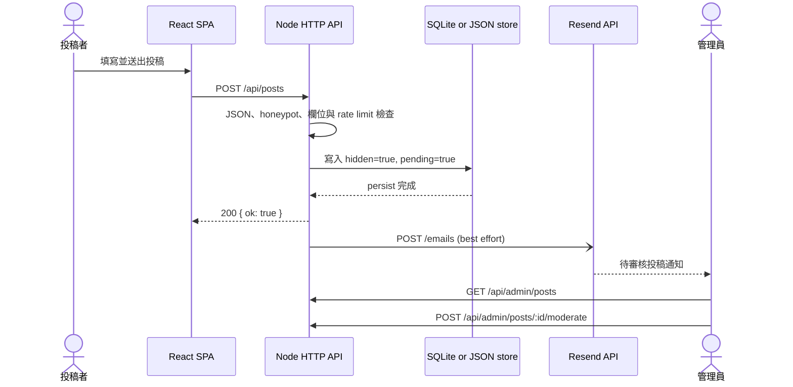

# 投稿 Email 通知：技術設計與運維

## 目標與邊界

經驗分享頁允許訪客投稿。投稿必須先安全寫入資料層並標記為 `hidden + pending`，再由後端通知管理員到後台審核。Email 是管理效率工具，不是投稿交易本身的一部分，因此採用 **persist first、best-effort notification**：郵件供應商失敗時，投稿仍然成功且不會遺失。

這項功能刻意不做以下事情：

- 不從瀏覽器直接呼叫郵件服務，避免 API Key 暴露。
- 不省略投稿全文；內文會隨通知寄給 Resend 與管理員，以便直接在信中初步審閱。
- 不要求 Cloudflare Email Routing；Email Routing 是收信／轉寄功能，本功能只需要 Resend 的寄信網域驗證。
- 不把 Email 當成唯一待審核佇列；後台的 `pending` 投稿仍是 source of truth。

## Runtime 資料流



實際執行順序位於 `server/ratings-api.mjs`：

1. 解析 JSON request body。
2. 檢查隱藏的 `website` honeypot；機器人填入時回傳假成功，但不儲存、也不寄信。
3. 檢查文章上限、標題、內容與 IP rate limit。
4. 建立 UUID，強制設定 `hidden: true`、`pending: true`。
5. 寫入目前啟用的持久層（SQLite 或 JSON）。
6. 回傳投稿成功。
7. 在背景呼叫 Resend；錯誤只寫入 container log，不改變已完成的投稿結果。

## 郵件內容與 API request

`server/submission-email.mjs` 使用 Node 20 內建的 `fetch`，直接呼叫 `POST https://api.resend.com/emails`，不額外引入 SDK。這能降低 dependency surface 與 e2-micro runtime 的記憶體負擔。

Request 包含：

| 欄位 | 來源／用途 |
| --- | --- |
| `Authorization: Bearer ...` | `RESEND_API_KEY`，只存在 API container 環境變數 |
| `Idempotency-Key` | `submission-<post UUID>`，避免同一投稿重複寄送 |
| `from` | `SUBMISSION_EMAIL_FROM` |
| `to` | `SUBMISSION_NOTIFY_EMAIL`，逗號分隔後轉成陣列 |
| `subject` | `[待審核投稿] <標題>`，標題壓成單行並截到 100 字元 |
| `text` | 純文字通知，不使用 HTML template |

信件包含標題、作者、分類、台北時區投稿時間、投稿 UUID、投稿全文與管理後台 URL。投稿內文保留原本換行並以純文字寄送；IP、管理員 token、API Key 都不會進入信件。API request 使用 5 秒 timeout；非 2xx response 會讀取最多 300 字元的錯誤內容供 log 診斷。

Resend 的 idempotency key 保存 24 小時，因此相同 UUID 與 payload 在時限內重送不會寄出第二封。這是供應商層的短期去重，不是永久寄送紀錄。

## 環境變數

| 變數 | 必要性 | 說明 |
| --- | --- | --- |
| `RESEND_API_KEY` | 啟用通知必填 | 建議使用只允許寄信、並限制到指定網域的 `sending_access` key |
| `SUBMISSION_NOTIFY_EMAIL` | 啟用通知必填 | 管理員收件信箱；多個地址用逗號分隔 |
| `SUBMISSION_EMAIL_FROM` | 啟用通知必填 | 顯示名稱與寄件地址，例如 `網站通知 <notifications@send.example.com>` |
| `ADMIN_BASE_URL` | 建議 | 信件中的後台連結；Compose 由 `ADMIN_DOMAIN` 產生 |

前三項必須同時存在才會啟用。全部未設定時安靜停用，方便本機開發；只設定部分欄位時，API 啟動 log 會列出缺少的變數，但不會讓 server 起不來。

可從範本建立正式設定：

```bash
cd /home/billwang_tech/bank_interview123_selector
cp deploy/.env.example deploy/.env
chmod 600 deploy/.env
```

既有正式環境不要覆蓋原檔，直接編輯 `deploy/.env` 補上三個變數即可。`deploy/.env` 已被 Git 忽略，不得 commit。

## Resend 與 Cloudflare DNS

建議在 Resend 使用獨立寄信子網域，例如 `send.example.com`。子網域能隔離寄信 reputation，也不需要放寬根網域既有的防偽造政策。

設定流程：

1. 在 Resend Domains 新增 `send.example.com`。
2. 將 Resend 當下提供的 SPF、DKIM 等 DNS 紀錄逐筆加入 Cloudflare；值以 Resend dashboard 為準，不要複製文件範例。
3. 郵件相關紀錄保持 **DNS only**，不要開 Cloudflare HTTP proxy。
4. 回到 Resend 執行驗證，確認 sending status 為 `Verified`。
5. 建立權限為 `Sending access` 的 API Key，並盡可能限制到該寄信網域。
6. 將寄件地址設成已驗證子網域，例如 `notifications@send.example.com`。

SPF 授權哪些主機可代替網域寄信，DKIM 讓收件端驗證郵件簽章；兩者是 Resend 寄信驗證的核心。Cloudflare Email Routing 的 MX／轉寄規則是 inbound mail 功能，與這條 outbound notification flow 無關。

官方參考：

- [Resend：Managing Domains](https://resend.com/docs/dashboard/domains/introduction)
- [Resend：Send Email API](https://resend.com/docs/api-reference/emails/send-email)
- [Resend：Idempotency Keys](https://resend.com/docs/dashboard/emails/idempotency-keys)
- [Resend：API Key security](https://resend.com/docs/knowledge-base/how-to-handle-api-keys)

## 部署與安全驗證

Compose 明確把四個相關變數注入 `api` container；修改 `deploy/.env` 後需重建 container 的環境：

```bash
cd /home/billwang_tech/bank_interview123_selector
DC="docker compose -f deploy/docker-compose.yml --env-file deploy/.env"
$DC up -d api
```

只確認變數是否存在，不把 secret 印到 terminal：

```bash
$DC exec api node -e '
for (const key of ["RESEND_API_KEY", "SUBMISSION_NOTIFY_EMAIL", "SUBMISSION_EMAIL_FROM", "ADMIN_BASE_URL"]) {
  console.log(`${key}: ${process.env[key] ? "set" : "missing"}`);
}'
```

正式驗證：

1. 確認 Resend Domains 為 `Verified`。
2. 從公開網站送出一篇可辨識的測試投稿。
3. 確認前端顯示成功，後台同時出現 `pending` 投稿。
4. 確認收件信箱與 Resend Logs 都有對應郵件。
5. 在後台刪除測試投稿，避免測資殘留。
6. 若未收到信，檢查 `$DC logs --tail=100 api` 中的 `[submission-email]`。

## Failure modes 與取捨

| 情況 | 投稿結果 | 通知結果／診斷 |
| --- | --- | --- |
| 三個必要變數全部未設定 | 正常 | 功能安靜停用 |
| 只有部分變數 | 正常 | 功能停用，啟動 log 列出缺項 |
| DNS 尚未 verified／寄件網域不符 | 正常且保留 | Resend 回 4xx，API log 記錄錯誤 |
| API Key 無效或撤銷 | 正常且保留 | Resend 回 401／403 |
| 網路中斷或 Resend timeout | 正常且保留 | 5 秒後 abort，API log 記錄錯誤 |
| 同一投稿在 24 小時內重送通知 | 不受影響 | idempotency key 防止重複寄送 |
| API process 在背景 request 完成前終止 | 已 persist 的投稿仍在 | 該封通知可能遺失，後台仍可看到 pending 投稿 |

目前沒有 durable job queue、outbox table 或自動 retry。這是針對單機 e2-micro side project 的刻意取捨：功能簡單、零額外常駐服務，且 Email 不是 source of truth。若未來投稿量或通知可靠性需求提高，可改成 transactional outbox：與投稿同一 transaction 寫入 notification job，由 worker 重試並記錄 provider message ID。

## 安全性與隱私

- Secret 只存在 VM `deploy/.env` 與 API container environment，不進前端 bundle、Git 或 Email。
- 建議 API Key 採最小權限 `sending_access`，定期輪替；新舊 key 短暫並存，驗證新 key 後再刪舊 key。
- 投稿全文會由 Resend 處理並寄至設定的管理員信箱；應只設定可信任的收件人，並依站方隱私政策管理信件留存。
- Honeypot、驗證失敗、超量與 rate-limited request 都在寄信呼叫前返回，避免被濫用成寄信放大器。
- Provider error 不包含 Authorization header；程式也不會把 API Key 寫入 log。
- 多收件人會放在 Resend `to` 陣列；若收件人之間不應互相看到地址，應改用單一管理群組地址或未來切換成 BCC。

## 測試與程式位置

| 檔案 | 責任 |
| --- | --- |
| `src/lib/posts.ts` | 前端送出 `POST /api/posts` |
| `server/ratings-api.mjs` | 驗證、持久化、回應與觸發通知 |
| `server/submission-email.mjs` | 組信、環境設定、Resend request、timeout 與錯誤處理 |
| `server/submission-email.test.mjs` | 停用模式、成功 payload、去重 header、錯誤與 secret 保護 |
| `deploy/docker-compose.yml` | 將正式環境變數注入 API container |
| `Dockerfile.api` | 把通知模組封裝進 production API image |

驗證指令：

```bash
npm test -- server/submission-email.test.mjs
npm test
npm run typecheck
npm run test:parity
npm run build
```

單元測試使用注入的 fake `fetch`，不會真的寄信；`test:parity` 會驗證投稿在 JSON 與 SQLite backend 都維持 `hidden + pending` 的持久化語意。
