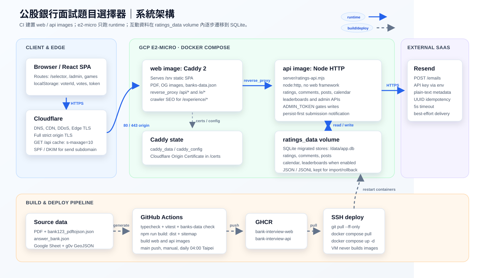

# 系統架構圖

這張圖依目前 repo 的實際檔案整理：Vite React SPA、Cloudflare（含 Turnstile）、Caddy web container、Node HTTP API、Docker Compose、GitHub Actions、GHCR、VM 本機 Docker volume 持久化，以及投稿後使用的 Resend Email API。README 直接嵌入同一張 SVG，這裡補充圖上的判讀方式與資料層細節。

> 註：實線是 runtime 請求流，虛線是建置／部署流。

## 圖上的重點

- 前端是 Vite React SPA，正式環境由 `web` image 內的 Caddy 服務 `/srv` 靜態檔。
- Caddy 直接服務 SPA、PDF、OG 圖、`banks-data.json`，並把 `/api/*`、`/e/*`、爬蟲用的 `/experience/*` SEO HTML 反向代理到 API。
- API 是輕量 Node `node:http` sidecar：`server/ratings-api.mjs`，不引入 Express 之類的 web framework。
- 使用者互動資料存進 Docker volume `ratings_data`。目前是 SQLite 遷移狀態：已切換的資料讀寫 `/data/app.db`，原 JSON / JSONL 檔保留作為匯入來源與回滾安全網。
- Cloudflare 負責 DNS、CDN/TLS/DDoS、公開 GET API 的短快取，以及投稿／留言的 Turnstile challenge；寫入和 admin API 不走 cache。
- Resend 是唯一的 runtime Email SaaS 依賴：API 在投稿完成持久化後呼叫 `POST /emails`，API Key 由 Compose 注入，DNS 驗證使用獨立寄信子網域。
- GitHub Actions 負責 typecheck、Vitest、`check:banks-data`、前後端 image build/push；e2-micro VM 只 `docker compose pull && up -d`，避免在 1GB RAM 機器上建置。

## 資料層

JSON / JSONL 檔目前仍留在同一個 `ratings_data` volume，包含評分、題目留言（留言／投票／後台隱藏）、文章留言（留言／投票／後台隱藏）、經驗分享文章、文章投票、行事曆、兩個小遊戲排行榜。這些檔案在遷移期主要作為匯入來源與回滾安全網。

SQLite 不是外部資料庫服務；它仍在 API container 內用 `better-sqlite3` 存取 `/data/app.db`。依目前 `server/ratings-api.mjs`，`USE_SQLITE=1` 時 ratings、comments、posts、calendar、leaderboards 都會走 SQLite 持久層。正式切換與備份步驟見 [deploy/SQLITE-CUTOVER.md](../deploy/SQLITE-CUTOVER.md)。

## 投稿通知邊界

投稿交易與 Email 通知刻意解耦：`POST /api/posts` 先驗證並寫入 `hidden + pending` 文章，成功後才在背景呼叫 Resend。Provider timeout、DNS 驗證或 API Key 問題只會留下 `[submission-email]` log，不會回滾投稿。後台 pending list 是可靠的待審核來源，Email 只是提示管道。

這個設計省去常駐 queue／worker，符合單機 e2-micro 的成本與記憶體限制；代價是 API process 若在背景 request 完成前終止，該封通知可能遺失。需要更高可靠性時，演進方向是 SQLite transactional outbox + retry worker。完整設計見 [投稿 Email 通知：技術設計與運維](submission-email-notifications.md)。

## 公開寫入安全邊界

React widget 取得的 Turnstile token 不直接代表信任。`POST /api/posts` 與兩套留言 API 都由 Node
server 將 token、server-only secret 與 client IP 送到 Siteverify，並驗證 hostname/action；通過後才
執行既有 per-IP rate limit 與資料寫入。Siteverify timeout 或失敗採 fail closed，Email 也不會觸發。
完整 sequence、failure matrix 與金鑰輪替見 [Cloudflare Turnstile：投稿與留言防濫用設計](turnstile-bot-protection.md)。
