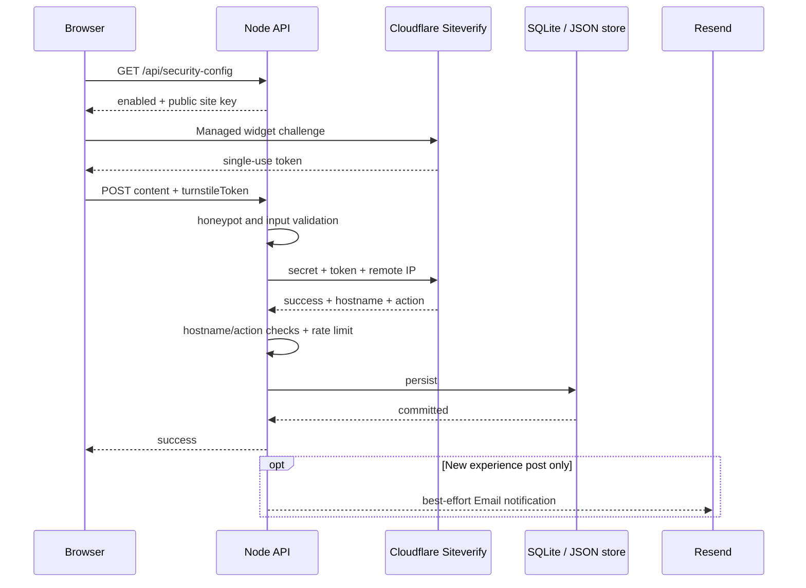

# Cloudflare Turnstile：投稿與留言防濫用設計

## 目標與範圍

公開投稿與匿名留言都會產生持久化資料，投稿成功後還會觸發 Resend 通知，因此是自動化濫用最有
價值的入口。本專案在既有 honeypot、輸入驗證、每 IP rate limit、待審核流程之外，加入
Cloudflare Turnstile 的 Managed widget，保護：

- `POST /api/posts`：使用者投稿，action 為 `post-submit`。
- `POST /api/comments/:questionId`：題目留言，action 為 `comment-submit`。
- `POST /api/post-comments/:postId`：文章留言，action 為 `comment-submit`。

一般評分、文章投票與留言投票不要求 Turnstile，避免每次輕量互動都增加摩擦；這些端點仍保留
原本的格式驗證與資料覆寫規則。

## Request flow



前端 widget 只負責取得 token，不能當作授權依據。API 每次都呼叫 Cloudflare Siteverify，並檢查：

1. token 存在且長度不超過 2,048 字元；
2. Siteverify 回傳 `success: true`；
3. `hostname` 在 `TURNSTILE_EXPECTED_HOSTNAMES` allowlist；
4. `action` 與 API 路由預期用途相符；
5. Cloudflare 看到的 remote IP 由 `CF-Connecting-IP` 優先取得，才退回 reverse-proxy header。

驗證 request 帶 UUID `idempotency_key`。Turnstile token 具有時效、且只能成功驗證一次；表單在失敗或
留言送出後會 reset widget，避免重送已使用的 token。

## 金鑰與 runtime configuration

```dotenv
TURNSTILE_SITE_KEY=0x4AAAA...
TURNSTILE_SECRET_KEY=0x4AAAA...
TURNSTILE_EXPECTED_HOSTNAMES=bank-interview-advisor.com,www.bank-interview-advisor.com
TURNSTILE_TIMEOUT_MS=5000
```

- Site key 是公開識別值，由 `GET /api/security-config` 在 runtime 提供給 React；因此不需要把 key
  烤進 Vite image，也不需要為 key rotation 重建 web image。
- Secret key 只注入 API container，僅用於 Siteverify，永遠不透過 API response 或前端 bundle 回傳。
- 兩把 key 都沒設定時視為「刻意停用」，方便本機與尚未啟用的環境。
- 只設定其中一把視為部署錯誤：受保護寫入會 fail closed 並回 `503`，container 啟動時也會記錄
  `[turnstile] misconfigured`，避免看似啟用但實際繞過後端驗證。

## Failure policy

| 狀況 | HTTP | 行為 |
| --- | ---: | --- |
| 未提供 token | 400 | 不呼叫 Siteverify、不寫入 |
| token 無效、過期或重複使用 | 400 | 要求 widget reset 後重試 |
| hostname/action 不符 | 400 | 拒絕寫入，避免跨站或跨用途 token |
| Siteverify 非 2xx、timeout、network error | 503 | fail closed，不寫入 |
| key 只設定一半 | 503 | fail closed，啟動 log 顯示缺少欄位 |
| honeypot 被填入 | 200（假成功） | 不呼叫 Siteverify、不寫入，降低 bot 調整訊號 |
| Turnstile 驗證成功但 rate limit 超限 | 429 | 不寫入，前端 reset token |

投稿只有在 Turnstile、rate limit 與輸入檢查全數通過並完成持久化後才可能寄 Email，因此無效流量
不會放大成 Resend API 呼叫。

## Cloudflare widget 設定

- Widget name：`bank-interview-advisor`
- Mode：Managed
- Allowed hostnames：`bank-interview-advisor.com`、`www.bank-interview-advisor.com`
- Pre-clearance：關閉；本專案只把 token 用於指定 API 寫入，不讓它繞過其他 WAF challenge。

另外在 zone 啟用 `/.well-known/security.txt`，提供聯絡方式、到期日、語言與 canonical URL；帳戶本身
則應另啟用 MFA。Security.txt、Turnstile 與 MFA 解決的是不同層級：弱點揭露、應用程式濫用與帳戶接管。

## 部署與驗證

1. 把四個變數加入 VM 的 `deploy/.env`，檔案權限維持 `600`。
2. 重新建立 API container，讓 Compose 注入新環境變數。
3. 以 `GET /api/security-config` 確認只回傳 public site key，不含 secret。
4. 用正式頁面送出一筆測試投稿與留言，確認 widget 完成後才可送出。
5. 對相同 request 重送 token，應收到 `400`；移除 token 也應收到 `400`。
6. 確認投稿在管理後台與通知信箱出現後，刪除測試投稿／留言，避免正式資料殘留測資。

本機預設不設定 Turnstile keys，因此 widget 不顯示、後端沿用既有保護。若要測真實 widget，可在
Cloudflare 建立允許 `localhost` 的測試 widget，並把 `localhost` 加進 expected hostnames；不要把正式
secret 寫進 repo 或 shell history。

## 測試與維運

`server/turnstile.test.mjs` 以 mock fetch 覆蓋停用模式、部分設定 fail-closed、缺 token、成功驗證、
hostname/action mismatch 與 provider failure。部署後可用以下方式只確認變數是否存在，不輸出內容：

```bash
DC="docker compose -f deploy/docker-compose.yml --env-file deploy/.env"
$DC exec api node -e '
for (const key of ["TURNSTILE_SITE_KEY", "TURNSTILE_SECRET_KEY", "TURNSTILE_EXPECTED_HOSTNAMES"]) {
  console.log(`${key}: ${process.env[key] ? "set" : "missing"}`);
}'
```

若 secret 曾出現在 log、截圖或公開紀錄，應立即在 Cloudflare Turnstile widget 旋轉 secret，更新
`deploy/.env`，再只重建 API container。Site key 通常可保留，secret rotation 不需要重建前端。
